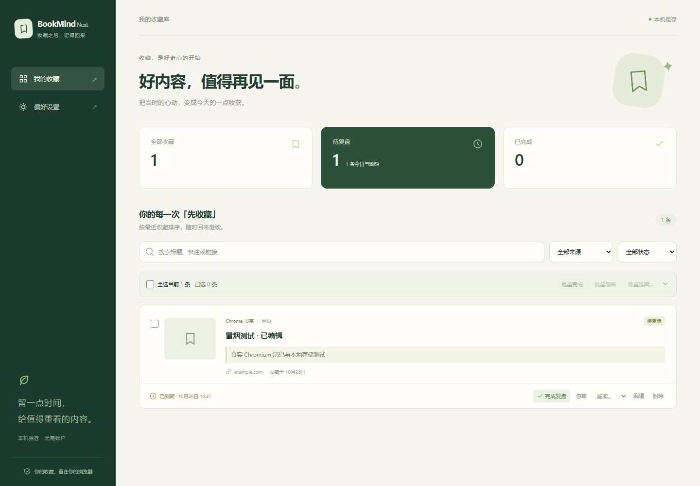
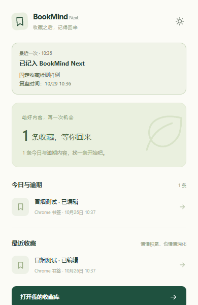
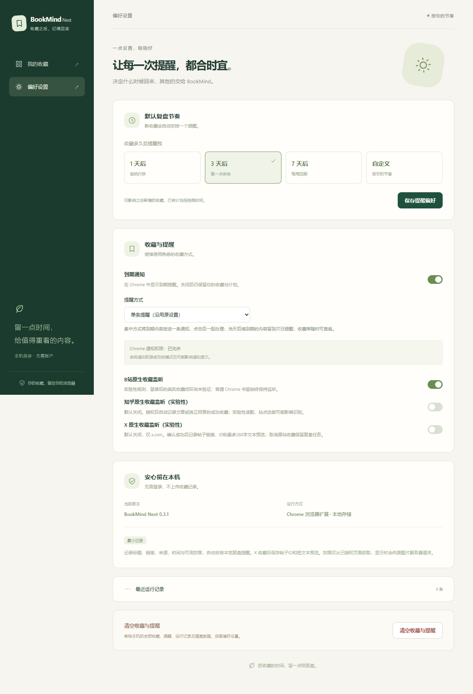

# BookMind Next — 收藏警长

**Saved it? The sheriff would like a word.**

BookMind Next (收藏警长) is a local-first Chrome extension for turning your heroic pile of saved links into reminders you might actually open. The sheriff does not issue tickets; it just taps the badge when a link has waited long enough.

收藏夹不是“改天再看”研究院，更不是网页养老院。收藏警长不罚款、不抓人，只负责给链接发回访通知：“这条你收藏时挺积极，什么时候回来看看？”

## What it does

- Records newly created Chrome bookmarks and schedules a review reminder. Existing bookmarks and bulk imports are left alone.
- Detects successful native favorites on Bilibili. Zhihu and X support is experimental and disabled until you enable it and grant the optional site permission.
- Lets you search, edit, complete, postpone, ignore, or remove review tasks.
- Keeps favorites and reminders in the browser profile. There is no account, backend, cloud sync, or collection-history upload.

This project does not read cookies, passwords, or full-page text. The optional X integration stores a short visible post preview to help identify the saved link. Cover images may be loaded from their original image host.

## Product screenshots

These screenshots use fictional demo entries only; they contain no personal bookmark data.
以下界面图使用虚构示例内容，不包含真实收藏数据。

### Review dashboard

### Browser popup

Settings

## Build and install

Requirements: Node.js 22.12 or newer and pnpm 11.25.0.

~~~sh
corepack enable
corepack prepare pnpm@11.25.0 --activate
pnpm install --frozen-lockfile
pnpm build
~~~

In Chrome, open chrome://extensions, turn on Developer mode, choose Load unpacked, and select .output/chrome-mv3. The extension requires Chrome 120 or newer. Chromium-based browsers may vary in compatibility.

To work on the extension with live rebuilds, run pnpm dev. To run the project's type checks and automated tests, run pnpm check.

## Permissions and support

The extension uses browser bookmarks, local storage, alarms, notifications, and active-tab scripting. Bilibili is the required site permission. Zhihu and X are optional permissions requested only when their experimental integrations are enabled in Settings.

Website interfaces can change. Zhihu and X integrations remain experimental, and some bookmark actions without a clear success state may not be detected. See the extension's Settings page for the current site controls.

## Roadmap

Planned work includes improving reliability as supported sites change their interfaces, expanding the browser acceptance guide, and publishing repeatable release packages after each version is verified. We may explore user-controlled export and import later. Any synchronization feature would need a clear opt-in and privacy design.

These are project plans, not release commitments. Bug reports and focused contributions are welcome.

## Contributing

Please read CONTRIBUTING.md. When reporting a problem, remove private page URLs, account details, cookies, and saved-content screenshots.

## License

This project is available under the MIT License (see LICENSE).
